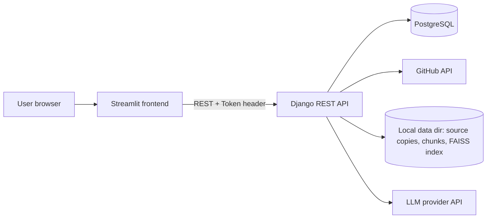

# RepoPilot AI

**Understand Your Codebase. Ship with Confidence.**

RepoPilot AI is an AI-powered code intelligence app. Connect a public GitHub repository, explore its structure, search it by keyword or by meaning, ask questions about how it works, investigate bugs, and review small AI-proposed fixes. Every AI answer is built from code that was actually retrieved from the repository, and the UI shows exactly which files and lines were used.

> Built as a placement project: a Streamlit frontend, a Django REST backend, PostgreSQL, Tree-sitter parsing, BM25 + FAISS hybrid search, and a configurable LLM.

---

## 1. Main features

| Area | What it does |
|---|---|
| Landing page | Product page with an example session, features, how-it-works, working navigation |
| Authentication | Register / sign in / sign out with Django's password hashing and token auth |
| Dashboard | Real counts, repository cards, recent analyses, empty state for new users |
| GitHub connection | Validates a public `https://github.com/owner/repo` URL, reads metadata through the GitHub API, safely downloads source files |
| Analysis | Filters files, parses code with Tree-sitter, chunks by function/class, builds BM25 + FAISS indexes |
| Search | Hybrid, keyword-only or meaning-only search, plus a repository overview (files, functions, classes) |
| AI assistant | Retrieves code, asks the LLM, shows the answer with evidence and assumptions separated |
| Bug investigation | Reads tracebacks, jumps to the exact code, returns *hypotheses* (never "confirmed bugs") |
| Fix suggestions | One minimal change as a diff, validated against the real file, approve/reject, optional apply to a **local** copy only |
| History | Every question/investigation saved in PostgreSQL; view and delete your own records |

## 2. Technology stack

| Component | Technology |
|---|---|
| Language | Python 3.12 (3.11 also works) |
| Frontend | Streamlit + custom CSS/HTML components |
| Backend | Django 5 + Django REST Framework |
| Database | PostgreSQL (Django ORM) |
| Code parsing | Tree-sitter (Python, JavaScript, TypeScript/TSX, Java, Go) |
| Semantic search | Sentence Transformers + FAISS |
| Keyword search | BM25 (`rank-bm25`) |
| AI | Configurable LLM API (OpenAI-compatible or Anthropic), isolated in `ai_engine/llm.py` |
| GitHub | GitHub REST API (metadata + zip archive download) |
| Tests | pytest + pytest-django |
| Packaging | Docker + Docker Compose |

## 3. Folder structure

```text
RepoPilot-AI/
├── frontend/
│   ├── app.py               # pages, navigation, interaction logic
│   ├── api_client.py        # calls the Django REST API
│   ├── components.py        # HTML building blocks (code blocks, diffs, cards, landing sections)
│   ├── styles.css           # visual identity
│   ├── test_frontend.py     # frontend unit tests
│   ├── .streamlit/config.toml
│   ├── requirements.txt
│   └── Dockerfile
├── backend/
│   ├── manage.py
│   ├── config/              # settings.py, test_settings.py, urls.py, wsgi.py, asgi.py
│   ├── repositories/        # models, serializers, views, urls, permissions, services, tests, migrations
│   ├── ai_engine/           # parser, indexing, search, llm, assistant, bug_analyzer, tests
│   ├── conftest.py  pytest.ini
│   ├── requirements.txt
│   └── Dockerfile
├── .env.example  .gitignore  .dockerignore
├── docker-compose.yml
└── README.md
```

Two small additions to the requested layout: `ai_engine/llm.py` (keeps all provider-specific code in one file) and `config/test_settings.py` (makes tests always use an in-memory SQLite database, never your real one).

## 4. Architecture



**Why this design (good interview answers)**

- **Streamlit never touches the database.** All business logic, auth and ownership checks live in Django, so the API is the single source of truth and can be reused by another UI later.
- **Token authentication.** The Streamlit *server* keeps the token in its session memory and sends `Authorization: Token ...`. No passwords are stored, and no cookies are used by the API, so CSRF does not apply to it. Logout deletes the token on the server.
- **Embeddings are not in PostgreSQL.** Vectors and indexes are files in a per-repository folder (`data/indexes/<random-id>/`); PostgreSQL stores users, repositories, history and fix suggestions.
- **No Celery/Redis.** Analysis runs inside the request (simple to explain). The trade-off: very large repositories make the request slow; limits keep it bounded.

## 5. The AI retrieval pipeline

```
Repository files -> Code chunks -> BM25 + FAISS -> Relevant excerpts -> LLM -> Answer with evidence
```

1. **Read & filter** (`indexing.read_source_files`): skips dependency/build folders, lock files, generated files, binaries, oversized files, symlinks and anything that looks like a secret (`.env`, `*.pem`, keys), so secrets are never indexed or sent to an LLM.
2. **Parse** (`parser.parse_source`): Tree-sitter finds functions, classes and methods. Unsupported languages are *not* claimed as parsed; they are indexed as plain text.
3. **Chunk** (`indexing.create_chunks`): one chunk per function/method; class headers and module-level code get their own chunks; long chunks are split into overlapping line windows.
4. **Embed + FAISS** (`embed_texts`, `build_faiss_index`): Sentence Transformers vectors, normalised, in a FAISS inner-product index.
5. **BM25** (`search.keyword_search`): code-aware tokenizer (splits `snake_case` and `camelCase`).
6. **Hybrid ranking** (`search.reciprocal_rank_fusion`): each method ranks chunks; a chunk's score is the sum of `1 / (60 + rank)` over the methods that found it. Chunks found by both rise to the top, and scores from different methods never need to be compared.
7. **LLM** (`assistant.answer_question`): only the top excerpts plus a file outline are sent. The prompt says repository text is *untrusted data*, tells the model to cite `path:start-end`, to separate evidence from assumptions, and to admit when the code is insufficient.

If semantic search is unavailable (model not installed or not downloaded), the API says so (`mode_used: "keyword"` plus a note) and the UI shows it. It never pretends.

## 6. Environment variables

Copy `.env.example` to `.env`. Key variables:

| Variable | Purpose |
|---|---|
| `DJANGO_SECRET_KEY` | Required. Generate: `python -c "import secrets; print(secrets.token_urlsafe(50))"` |
| `DJANGO_DEBUG` | `true` for local development, `false` otherwise |
| `POSTGRES_DB/USER/PASSWORD`, `DB_HOST`, `DB_PORT` | Database connection |
| `BACKEND_URL` | Where Streamlit finds Django (`http://localhost:8000`; Compose sets `http://backend:8000`) |
| `LLM_PROVIDER`, `LLM_API_KEY`, `LLM_MODEL`, `LLM_BASE_URL` | LLM configuration (section 9) |
| `GITHUB_TOKEN` | Optional, server-side only; raises GitHub's rate limit for **public** data |
| `SEMANTIC_SEARCH_ENABLED`, `EMBEDDING_MODEL` | Turn semantic search on/off; choose the model |
| `MAX_FILES`, `MAX_FILE_KB`, `MAX_REPO_SIZE_KB`, `MAX_ARCHIVE_MB`, `MAX_EXTRACTED_MB`, `MAX_CHUNKS` | Processing limits |

## 7. Local installation on Windows (PowerShell + VS Code)

**Prerequisites:** Python **3.12** (tick "Add python.exe to PATH"), PostgreSQL 16 ([postgresql.org](https://www.postgresql.org/download/windows/)), Git, VS Code. Docker Desktop is only needed for section 11.

Run every command in the VS Code terminal (PowerShell), starting in the folder that contains `RepoPilot-AI`.

```powershell
cd RepoPilot-AI
copy .env.example .env          # then open .env and fill in the values (section 6)

python -m venv .venv
# If activation is blocked, run once:  Set-ExecutionPolicy -Scope CurrentUser RemoteSigned
.\.venv\Scripts\Activate.ps1

python -m pip install --upgrade pip
pip install -r backend/requirements.txt -r frontend/requirements.txt
```

The first install is large (PyTorch comes with `sentence-transformers`). If you only want keyword search, set `SEMANTIC_SEARCH_ENABLED=false` in `.env`; everything else works.

## 8. PostgreSQL setup

Open **SQL Shell (psql)** from the Start menu (or run `& "C:\Program Files\PostgreSQL\16\bin\psql.exe" -U postgres`), sign in as `postgres`, then:

```sql
CREATE USER repopilot WITH PASSWORD 'your-password-here';
CREATE DATABASE repopilot OWNER repopilot;
\q
```

Put the same user/password/database in `.env` (`POSTGRES_USER`, `POSTGRES_PASSWORD`, `POSTGRES_DB`, `DB_HOST=localhost`).

## 9. LLM API configuration

RepoPilot has no hard-coded model or provider. Set these in `.env`, restart the backend, and check `http://localhost:8000/api/health/` (`"llm_configured": true`). Without them the app still runs, and AI pages show a setup message.

| Provider | `LLM_PROVIDER` | `LLM_BASE_URL` | `LLM_MODEL` |
|---|---|---|---|
| OpenAI | `openai_compatible` | *(leave empty)* | a model from your OpenAI account |
| Anthropic | `anthropic` | *(leave empty)* | a model from the Anthropic docs |
| Groq / OpenRouter / Gemini (OpenAI endpoint) | `openai_compatible` | e.g. `https://api.groq.com/openai/v1` | the provider's current model id |
| Local Ollama | `openai_compatible` | `http://localhost:11434/v1` | your pulled model (no key needed) |

Model names change over time: copy one from your provider's current documentation. Your key stays on the server and is never sent to the browser or logged.

## 9b. Run the application

Open **two** PowerShell windows (activate the venv in each: `.\.venv\Scripts\Activate.ps1`).

```powershell
# Window 1: backend
cd backend
python manage.py migrate
python manage.py runserver 8000
```
```powershell
# Window 2: frontend
cd frontend
streamlit run app.py
```

Open **http://localhost:8501**, create an account, connect a repository, press **Analyze**, then use Search / Ask the AI.

Optional: `python manage.py createsuperuser` and visit `http://localhost:8000/admin/` (needs `DJANGO_DEBUG=true` for static files).

## 10. Testing

```powershell
cd backend
pytest            # 147 backend tests (API, security, search, LLM layer)
cd ..\frontend
pytest            # 6 frontend tests
```

Backend tests run on in-memory SQLite and never need PostgreSQL, a network, an embedding model or a real LLM key.

## 11. Docker

```powershell
copy .env.example .env     # set DJANGO_SECRET_KEY, POSTGRES_PASSWORD, LLM_* values
docker compose up --build -d     # build and start db + backend + frontend
docker compose ps                # status
docker compose logs -f backend   # follow logs (also: frontend, db)
docker compose down              # stop (add -v to also delete database and data volumes)
```

Frontend: http://localhost:8501. API: http://127.0.0.1:8000 (bound to your machine only). PostgreSQL is **not** published; it sits on an internal network with no internet access. Migrations run automatically when the backend starts. The first semantic analysis downloads the embedding model into the `repopilot_data` volume. If your LLM is Ollama on your PC, use `LLM_BASE_URL=http://host.docker.internal:11434/v1`.

## 12. API endpoints

All JSON. Everything except register/login/health requires `Authorization: Token <key>`. Another user's object always returns **404**.

| Method | Path | Purpose | Success |
|---|---|---|---|
| GET | `/api/health/` | Liveness + whether an LLM is configured | 200 |
| POST | `/api/auth/register/` | `{username, password, email?}` -> `{token, user}` | 201 |
| POST | `/api/auth/login/` | `{username, password}` -> `{token, user}` | 200 |
| POST | `/api/auth/logout/` | Invalidates the token | 204 |
| GET | `/api/auth/me/` | Current user | 200 |
| GET | `/api/dashboard/` | Real counts + 5 recent analyses | 200 |
| GET / POST | `/api/repositories/` | List yours / connect `{url}` | 200 / 201 |
| GET / DELETE | `/api/repositories/<id>/` | Details / remove (files, index, history, fixes) | 200 / 204 |
| POST | `/api/repositories/<id>/analyze/` | Build the search index | 200 |
| GET | `/api/repositories/<id>/overview/` | Files, languages, functions/classes, skipped counts | 200 |
| POST | `/api/repositories/<id>/search/` | `{query, mode: hybrid\|keyword\|semantic, top_k}` | 200 |
| POST | `/api/repositories/<id>/ask/` | `{question}` -> answer + references (saved to history) | 200 |
| POST | `/api/repositories/<id>/investigate/` | `{description}` -> hypothesis + references (saved) | 200 |
| POST | `/api/repositories/<id>/suggest-fix/` | `{description}` -> validated pending suggestion | 201 |
| GET | `/api/fixes/?repository=<id>` | List your suggestions | 200 |
| GET / DELETE | `/api/fixes/<id>/` | Detail / delete | 200 / 204 |
| POST | `/api/fixes/<id>/review/` | `{decision: approved\|rejected}` | 200 |
| POST | `/api/fixes/<id>/apply/` | Apply an **approved** change to the **local copy** only | 200 |
| GET | `/api/history/?repository=<id>&type=question\|bug` | List your records | 200 |
| GET / DELETE | `/api/history/<id>/` | Open / delete a record | 200 / 204 |

Common errors: `400` validation, `401` not signed in, `404` not found or not yours, `409` repository not analyzed / fix not approved, `413` repository too large, `422` unsafe or invalid patch, `429` GitHub or API rate limit, `502` LLM or GitHub failure, `503` LLM not configured (`code: "llm_not_configured"`).

## 13. Security measures

- **Auth:** Django password hashing and password validators; token auth; auth endpoints are rate-limited; logout deletes the token.
- **Ownership:** every query is filtered by `owner=request.user`, plus an `IsOwner` object permission. Changing an ID in a request yields 404 (covered by tests).
- **Repository import / SSRF:** only `https://github.com/<owner>/<repo>` is accepted (credentials, other hosts, ports, query strings, extra path parts, `localhost`/IP addresses are rejected). The URL is parsed, never fetched; requests are built to `api.github.com` from validated names. Redirects are followed manually and only to GitHub hosts over HTTPS; the optional `GITHUB_TOKEN` is never sent to another host. Timeouts and download/extraction/file-count/file-size limits apply.
- **Archive safety:** zip-slip protection, symlinks skipped, only candidate source files extracted, declared sizes not trusted.
- **Secrets:** all keys come from environment variables; `.env` is git-ignored; secret-like files are never indexed; errors shown to users never contain keys.
- **AI safety:** repository text is treated as untrusted and wrapped in delimiter tags (look-alike tags are neutralised); the model is told never to follow instructions found in it; only top excerpts are sent. AI Markdown is rendered with images/links/HTML stripped, so an injected reply cannot make your browser load a remote URL. AI code is never executed.
- **Patches:** validated against the real file (path confined to the workspace, no symlinks, no secret/non-source files, original text must match exactly once, max size). Re-validated at apply time. Applying requires explicit approval and writes to the **local working copy only**. Nothing is ever committed or pushed to GitHub. Suggestions are always labelled unverified (`verified: false`) because RepoPilot never runs tests.
- **No test execution:** running imported tests is **not implemented** (it would need a locked-down Docker sandbox). Imported code is never executed on the server.

This project has been tested as described in section 14. It has not had an independent security review; do not describe it as production-secure.

## 14. What has actually been verified

| Item | Status |
|---|---|
| 147 backend + 6 frontend automated tests | **Executed, all passed** (SQLite) |
| Django migrations and API on real **PostgreSQL 16** | **Executed** (migrate + full UI flow below) |
| Full UI flow via Streamlit's headless test runner against the live backend: register, empty dashboard, URL rejection, analyze, search, repository overview, ask, bug investigation, fix suggestion, approve, apply, history, dashboard, sign out | **Executed**, using a local project source and a *fake* OpenAI-compatible LLM server |
| Tree-sitter parsing (Python, JS, TS, TSX, Java, Go) | **Executed** |
| BM25 and FAISS indexing/search | **Executed** (FAISS with a deterministic stand-in embedder) |
| Real Sentence Transformers model download and embedding | **Not verified** (no model download access in the build environment). Install and try it on your machine |
| Real GitHub import end to end | **Not verified live** (GitHub rate-limited the build environment). URL validation, metadata errors, rate limit, redirect handling, size limits and archive extraction are covered by mocked tests |
| Real LLM provider (OpenAI/Anthropic/etc.) | **Not verified**: request/response handling is unit-tested with mocks, never called with a real key |
| Docker images and Compose | **Not built or run** in the build environment. The files are provided but unverified |
| Visual design in a real browser | **Not verified**: the UI was exercised with Streamlit's headless runner, not viewed in a browser. In-page anchor links ("Features", "How it works", "Explore Features") rely on standard browser behaviour and were not browser-tested |

## 15. Known limitations

- Public repositories only; private repositories are rejected with a clear message.
- Login lasts for the Streamlit session: refreshing the browser tab signs you out (the token is deliberately kept out of browser storage). API tokens do not expire until logout.
- Analysis runs inside one request: big repositories can take minutes (limits apply). There is no progress bar.
- Tree-sitter covers Python, JS, TS/TSX, Java and Go; other languages use plain-text chunking.
- The first semantic analysis downloads an embedding model (internet needed once).
- The syntax highlighter is approximate (single-line tokens).
- Fix suggestions are single-file, single-snippet changes; CRLF files are handled, but a snippet the AI does not copy exactly is rejected.
- Test execution, private repositories and OAuth are not implemented.

## 16. Possible future improvements

Background analysis with progress; incremental re-indexing; private repositories through GitHub OAuth; multi-file patches; sandboxed test execution in a no-network Docker container; streaming answers; token expiry/refresh; exporting history; a call-graph view.

## 17. Interview cheat-sheet

- **"What does it do?"** It lets you ask questions about a codebase and answers from retrieved code with citations.
- **"Why hybrid search?"** BM25 nails exact names; embeddings find meaning. Reciprocal Rank Fusion combines the rankings without comparing incompatible scores.
- **"Why Tree-sitter?"** Chunking by function gives precise retrieval and lets me show functions/classes; fixed-size slicing cuts functions in half.
- **"How do you stop hallucinations?"** Evidence-only prompt, citations, an "assumptions and gaps" section, and "no results" short-circuits before calling the LLM. It reduces them; it does not eliminate them.
- **"What about prompt injection?"** Repo text is untrusted data in delimited tags, rendered output is stripped of images/links, and the model can never execute anything.
- **"How is data isolated?"** Owner-filtered querysets, 404 for others' objects, random workspace folder names, no filesystem paths in API responses.
